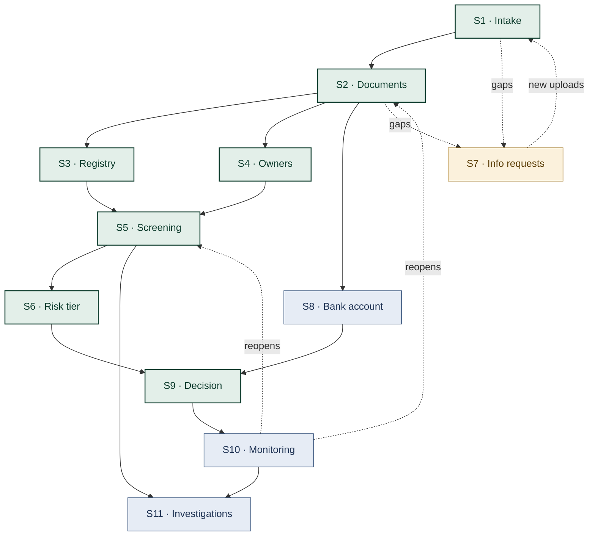

# Step 1: Research and breakdown

**Role:** Merchant onboarding (KYB) and compliance analyst
**Industry:** Payment gateways and payment-instrument issuers in emerging markets (Ethiopia, licensed by the National Bank of Ethiopia)

## 1. Why this role

A payment gateway can only take money for a business after it has checked who that business is (know your business, KYB).
It must also keep that check valid for as long as the merchant stays live.
The analyst who does this sits on the critical path for revenue and for regulatory risk at the same time:

- Every day a merchant waits for approval is a day of payments the gateway doesn't process. Slow onboarding also drives
  applicants away.
- Every merchant approved by mistake is a risk of a fine or a lost licence.

I built the back office of a regulated Ethiopian payment gateway, including its onboarding queue, document matrix,
risk tiers, sanctions screening, case management and daily compliance routines. So this breakdown comes from a
workflow I've implemented, not only from desk research.

## 2. What the role does

The core of the job matches O*NET's *Compliance Officer* tasks: "evaluate applications, records, or documents to determine
eligibility", "prepare reports of… decisions" and "report… violations to appropriate agencies"
([O*NET 13-1041.00](https://www.onetonline.org/link/summary/13-1041.00)). In a payment gateway that means three jobs:

1. **Decide** whether a business may start taking payments (onboarding).
2. **Keep the decision valid** over time (ongoing monitoring).
3. **Detect and escalate** financial crime (investigations and suspicious-transaction reports).

The rules behind it:

- **FATF:** Recommendation 10 covers customer due diligence, including the ultimate beneficial owner, and Recommendation
  24 covers beneficial-ownership transparency
  ([FATF Recommendations](https://www.fatf-gafi.org/content/dam/fatf-gafi/recommendations/FATF%20Recommendations%202012.pdf.coredownload.inline.pdf)).
- **Ethiopia:** payment-instrument issuers are licensed under NBE Directive ONPS/01/2020, which introduced tiered KYC
  ([IFLR](https://www.iflr.com/article/2gjw2n5ocpr2orkl4miqj/iflr1000/reflection-on-the-new-payment-instrument-issuers-directive)).
  It was amended in 2023, and a 2025 amendment reportedly requires real-time KYC and risk-based monitoring
  ([Addis Insight](https://addisinsight.net/2025/05/27/national-bank-of-ethiopia-issues-new-directive-to-strengthen-digital-payment-ecosystem/)).

### A day in the role, as it runs at an Ethiopian payment gateway

| When | What the analyst does |
|---|---|
| Morning | Works the onboarding queue, oldest first. For each application: checks the required documents for the merchant's legal form (sole trader vs share company), accepts or rejects each one with a note, and verifies the payout bank account. |
| Throughout | Screens the business and its owners against sanctions lists and the internal blacklist. Most hits are false positives that still need a written dismissal. |
| Throughout | Sends information requests with due dates and chases merchants who don't reply. |
| Per application | Assigns a risk tier (low, medium, high or prohibited) with a rationale, lists what still blocks approval, and writes the decision. A second person approves (maker-checker). |
| Ongoing | Opens a case 30 days before a merchant's licence expires, runs periodic reviews every 6, 12 or 24 months by risk tier, rescreens merchants when sanctions lists change, and drafts suspicious-transaction reports for peer review and filing. |

## 3. The cost of doing it by hand

| Measure | Figure | Source |
|---|---|---|
| Cost of one corporate KYC review (banks) | **$2,598**, up from $2,211 | [Fenergo via CCI](https://www.corporatecomplianceinsights.com/kyc-review-cost-survey-2023/) |
| Time for one corporate KYC review (banks) | **95 days**, up from 84 | [Fenergo](https://www.fenergo.com/newsroom/british-banks-grapple-with-more-costly-and-lengthy-kyc-procedures) |
| Manual merchant onboarding | **3–7 days**, vs minutes to hours when automated | [Payabli](https://payabli.com/learn/intelligent-payments/ai-merchant-onboarding/) (vendor) |
| Underwriting delayed by slow merchant replies | 12–24 h, stretching to **5 business days** | [Payrix](https://resource.payrix.com/docs/manual-underwriting-process.md) |
| Applicants who abandon financial onboarding | **68%** (Europe), mainly because of time and the data asked for | [Signicat via Fintech Times](https://thefintechtimes.com/68-of-european-consumers-abandon-financial-applications-during-onboarding-finds-signicat/) |
| False positives in name screening | **85–95%** (industry estimate) | [FluxForce](https://www.fluxforce.ai/statistics/sanctions-screening-accuracy-benchmark) |
| Analyst salary (US median) | KYC analyst **~$65k**; compliance officer **$80,730** | [Payscale](https://www.payscale.com/research/US/Job=KYC_Analyst/Salary), [O*NET](https://www.onetonline.org/link/summary/13-1041.00) |
| Cost of getting it wrong | Starling Bank **£29M** (2024): onboarded 49,000 high-risk customers despite a restriction, and screened only after onboarding. Block / Cash App **$40M** to NYDFS (2025) for KYC/AML failures and a backlog of suspicious-activity reports. | [King & Spalding](https://www.kslaw.com/insights/articles/fca-fines-starling-bank-over-financial-sanctions-screening-failures), [Banking Dive](https://www.bankingdive.com/news/block-cash-app-compliance-deficiency-new-york-penalty-fine-dfs/745554/) |

Bank KYC figures (Fenergo) overstate merchant KYB, which is lighter. The other figures come from vendors or industry
estimates, so read them as directional. Together they point the same way: the work is slow and expensive, about 9 in 10
of its alerts are noise, and mistakes are punished hard.

## 4. Sub-functions

Time shares are my estimates from running this workflow; no source publishes them.

| # | Sub-function | Inputs → outputs | Frequency | Time share | Human must still own |
|---|---|---|---|---|---|
| S1 | **Intake and completeness check** against the document matrix for the merchant's legal form | application, uploads → missing items, approval blockers | every application | 10% | changes to the matrix |
| S2 | **Document extraction and consistency** (trade licence, TIN, memorandum of association, owner IDs, expiry dates) | PDFs/images → structured fields, mismatches between documents and the form | every document | 20% | authenticity of doubtful documents |
| S3 | **Registry verification** (company register, LEI) | name, registration number → match or no match, registered officers | every business | 8% | accepting a non-match |
| S4 | **Owner and beneficial-owner identification** | memorandum, shareholder list → ownership tree | every business | 8% | layered-ownership judgement |
| S5 | **Sanctions, PEP and blacklist screening** with hit triage | names, dates of birth, countries → scored hits with a written rationale | every application and every list update | 15% | confirming a true match |
| S6 | **Risk classification** (category, geography, expected volume, structure) | S1–S5 results → tier and rationale | every application | 7% | final tier; "prohibited" calls |
| S7 | **Information requests and chasing** | gaps → emails, reminders, due dates | about half of applications | 12% | tone in edge cases |
| S8 | **Bank account verification** | bank letter, account name → match | every application | 4% | none |
| S9 | **Decision memo and approval** | S1–S8 → memo, approve or reject | every application | 6% | **the approval itself** (maker-checker) |
| S10 | **Ongoing monitoring**: documents expiring in 30 days, reviews every 6, 12 or 24 months, rescreening on list changes | merchant book, list changes → cases, renewal requests | daily | 6% | closing reviews |
| S11 | **Investigations and suspicious-transaction reports (STRs)** | alerts, linked payments → case, STR draft | rare | 4% | **peer review and filing with the regulator** |

### Dependencies

- The onboarding path S1 → S2 → S3/S4 → S5 → S6 → S9 is the critical path. Everything downstream depends on S2,
  so extraction quality caps the quality of the whole agent.
- S7 is a loop: it starts whenever S1 or S2 finds a gap, and ends when the merchant uploads again.
- S10 is what turns a one-time decision into a continuous one. It feeds back into S2 (renewed documents) and S5
  (rescreening).

## 5. Prioritization

Each sub-function is scored 1–5 on **value** (money or risk at stake), **frequency** and **automatability**. A
score is the product of the three, so the maximum is 125.

| Rank | Sub-function | Value | Freq. | Auto. | Score | Why |
|---|---|---|---|---|---|---|
| 1 | S2 Document extraction and consistency | 5 | 5 | 4 | **100** | The biggest time sink, on every document. A natural job for Gemini's document understanding. |
| 1 | S5 Screening and hit triage | 5 | 5 | 4 | **100** | Where fines happen. With 85–95% false positives, explaining why a hit is not a match saves the most analyst time. |
| 1 | S10 Ongoing monitoring | 5 | 5 | 4 | **100** | Runs daily, costs little, and is what regulators examine. It is also the agent's proactive side. |
| 4 | S6 Risk classification | 4 | 5 | 4 | 80 | Turns S1–S5 into one rationale a human can approve with one click. |
| 5 | S1 Intake and completeness | 3 | 5 | 5 | 75 | Rule-based and cheap. Must happen before S2. |
| 5 | S7 Information requests and chasing | 5 | 3 | 5 | 75 | Slow merchant replies are what stretch onboarding to days and drive the 68% drop-off. |
| 7 | S3 Registry verification | 4 | 5 | 3 | 60 | Strong where an open registry exists (LEI, UK). Ethiopia has no public registry API. |
| 7 | S9 Decision memo | 4 | 5 | 3 | 60 | The agent drafts the memo; a human makes the decision. |
| 9 | S4 Owner identification | 4 | 5 | 2 | 40 | Layered ownership needs human judgement. |
| 10 | S8 Bank account verification | 3 | 5 | 2 | 30 | Needs bank cooperation; no free API exists. |
| 11 | S11 Investigations and STRs | 5 | 1 | 2 | 10 | Rare, and filing is a legal act. Draft only. |

### What the agent should own

| Scope | Sub-functions |
|---|---|
| **The MVP agent owns** | S1 + S2, S5, S6 + S9 (memo only, a human approves), S7, S10 |
| **Assistive** | S3 (looked up through public registries where they exist), S4 |
| **Out of scope** | S8, S11 |

The agent doesn't replace the analyst's accountability; regulators hold the institution responsible. It does all the
preparation and follow-up, so **one analyst can clear a queue several times larger**, and the human time goes to the
decisions only a person may make.

## 6. Free data sources and APIs (no card required)

| API | Use | Terms, checked November 2026 |
|---|---|---|
| **Gemini API** (Google AI Studio key) | S2 extraction, S5 hit triage, S6/S9 rationale, S7 drafting | Free tier on the Flash models, no billing needed. **Free-tier content is used to improve Google's products**, so the demo uses synthetic documents only. ([pricing](https://aistudio.google.com/docs/pricing)) |
| **OFAC SDN and Consolidated lists** | S5, S10 | Free download, no key, with a delta archive for rescreening ([OFAC](https://ofac.treasury.gov/sanctions-list-service)) |
| **UN Security Council Consolidated List** | S5, S10 | Free XML, no key. The download path must be re-checked before building. ([UN](https://www.un.org/sc/suborg/en/sanctions/un-sc-consolidated-list.html)) |
| **GLEIF LEI API** | S3 | Free, no registration or key ([GLEIF](https://www.gleif.org/en/newsroom/blog/lei-look-up-api-gleif-answers-financial-industry-calls-to-enable-faster-customized-and-automated-access-to-the-legal-entity-identifier-data-pool)) |
| **UK Companies House API** | S3, S4 (officers and persons with significant control) | Free key, no card; 600 requests per 5 minutes ([guidelines](https://developer.company-information.service.gov.uk/developer-guidelines)) |
| **Gmail API** | S7 | Free for standard use; sending costs 100 of 6,000 units per user per minute ([quota](https://developers.google.com/workspace/gmail/api/reference/quota)) |
| **Google Calendar API** | S7, S10 (due dates, review calls) | Free; 600 requests per user per minute ([quota](https://developers.google.com/workspace/calendar/api/guides/quota)) |
| OpenSanctions *(not used)* | (S5) | Bulk data is CC BY-NC, and "compliance screening is a commercial use" even without revenue ([terms](https://www.opensanctions.org/docs/commercial/exemption/)). We use the official OFAC and UN lists instead. |

**Platform constraint:** Google's documentation says "a Google Cloud billing account is required to access the Google
Cloud Free Tier" ([GCP](https://docs.cloud.google.com/free/docs/free-cloud-features)), so Cloud Run, Cloud Scheduler
and Cloud Functions are not available without a card. Firebase's Spark plan needs no payment method and includes
Firestore and Hosting ([Firebase](https://firebase.google.com/pricing)). Step 2 chooses the hosting and scheduler
within this constraint.

## 7. Risks and caveats

- **No Ethiopian registry API.** Trade-licence and TIN checks against government systems stay manual, or are
  simulated in the demo. S3 uses GLEIF and Companies House where they apply.
- **Synthetic data only.** Real merchant documents never go to the Gemini free tier.
- **Human accountability.** The agent recommends, drafts and chases. A human approves merchants, confirms true
  sanctions matches and files STRs.
- **Soft numbers.** The figures from vendors and industry estimates are labelled as such. Re-check API quotas before
  the demo, because Google plans overage billing on Workspace APIs later in 2026.
