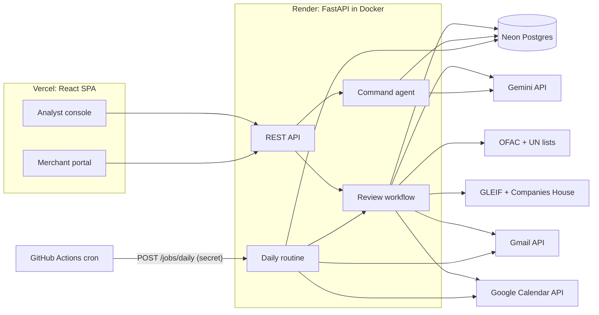
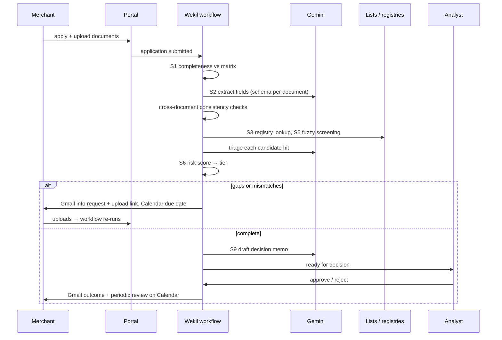

# Step 2: Solution design

**Product:** Wekil (ወኪል, Amharic for "agent" or "representative"), an AI KYB and compliance analyst for payment gateways
**Author:** Abenezer Alebachew · **Status:** draft for review · **Research:** [Step 1](01-research-and-breakdown.md)

## 1. Role and why

**Role:** Merchant onboarding (KYB) and compliance analyst at a payment gateway licensed by the National Bank of Ethiopia.

**Why this role:**

- **It sits on the revenue path and the regulatory path at once.** A merchant can't take a single payment until KYB is
  done, and a wrong approval can cost a licence.
- **The manual cost is high and well documented:**
  - a corporate KYC review costs $2,598 and takes 95 days at banks;
  - merchant onboarding takes 3–7 days by hand;
  - 68% of applicants abandon onboarding;
  - 85–95% of sanctions-screening hits are false positives;
  - recent fines include Starling Bank's £29M and Cash App's $40M.

  Sources are in [Step 1 §3](01-research-and-breakdown.md#3-the-cost-of-doing-it-by-hand).
- **The work suits an AI agent.** Most of the time goes on reading documents, comparing names, writing rationales and
  chasing people. Gemini does these well; the hard decisions stay with a human.
- **I've built this workflow before.** I built the back office of a regulated Ethiopian payment gateway: onboarding
  queue, document matrix, risk tiers, sanctions screening, maker-checker approvals and daily compliance routines. Wekil
  automates the analyst who works in such a system.

**Value proposition:**

| | Without Wekil | With Wekil |
|---|---|---|
| Time from complete application to decision | days of manual review | minutes |
| Analyst's job | prepares every file and chases every merchant | reviews a ready memo and makes the decision |
| Sanctions hits | each one dismissed by hand | each comes with a written triage |
| Monitoring (expiring documents, periodic reviews, rescreening) | depends on someone remembering | runs every morning |

## 2. What the agent handles

These are the high-priority sub-functions from [Step 1 §5](01-research-and-breakdown.md#5-prioritization).

| # | Workflow | Agent action | Human role |
|---|---|---|---|
| S1 | **Intake and completeness** | Checks the uploads against the required-documents matrix for the merchant's legal form (sole trader, PLC, share company) and lists approval blockers. | Maintains the matrix |
| S2 | **Document extraction and consistency** | Gemini reads each PDF or image (trade licence, TIN certificate, memorandum of association, owner ID) into structured fields. Code then compares the fields across documents and against the form: names, numbers, owners, expiry dates. | Judges doubtful documents |
| S3 | **Registry lookup** | Searches GLEIF (LEI) and UK Companies House for foreign or UK entities. Ethiopian entities go through a simulated registry, because no public API exists. | Accepts a non-match |
| S5 | **Sanctions screening and triage** | Code fuzzy-matches the business and owner names against the official OFAC and UN lists. For each candidate hit, Gemini compares the evidence (date of birth, nationality, address, entity type) and writes "likely the same / likely not the same" with its reasons. | Confirms a true match |
| S6 + S9 | **Risk tier and decision memo** | A rule-based score (category, country, ownership, hits, mismatches, expected volume) gives a tier of low, medium, high or prohibited. Gemini writes a one-page memo explaining the result. | **Approves or rejects** (maker-checker: the agent prepares, a human decides) |
| S7 | **Information requests and chasing** | Emails the merchant through Gmail with a single-use upload link and a due date, puts the due date on the compliance Google Calendar, reads the merchant's reply, sends reminders, then escalates. When new documents arrive, it re-runs the review. | Handles edge cases |
| S10 | **Ongoing monitoring (proactive)** | Every morning: refreshes the sanctions lists and rescreens approved merchants against new entries, opens renewal cases 30 days before documents expire, opens periodic reviews (every 6, 12 or 24 months by tier), chases overdue requests, and emails the analyst a digest. | Closes the cases |

**Deliberately out of scope:**

- **S8, bank account verification:** there's no free API for it.
- **S11, suspicious-transaction reports (STRs):** filing is a legal act, so the agent never files one.
- **S4, beneficial-owner trees:** the agent shows owners and officers but doesn't decide ultimate ownership.

## 3. Architecture



| Layer | Choice | Why |
|---|---|---|
| Frontend | React + Vite + TypeScript on **Vercel** (Hobby) | A responsive single-page app with two areas: the analyst console and the merchant portal. Free, no card. |
| Backend | **FastAPI** in Docker on **Render** (free web service) | Typed API and a long-running container, so a review can run in the background after an upload. Free, no card; sleeps after 15 minutes idle. |
| Database | **Neon** Postgres (free) | Relational data suits applications, cases and an append-only audit log. Documents are stored as binary data, since the demo files are small. Free, no card, no expiry. |
| Scheduler | **GitHub Actions** cron, 06:00 Addis Ababa time | Stands in for Cloud Scheduler, which needs billing. It calls a protected endpoint, lives in the repo, and also wakes the Render service. |
| AI | **Gemini** through a Google AI Studio key (`gemini-3.8-flash`, configurable) | Reads PDFs and images, returns output in a fixed JSON schema and supports function calling. Free tier. |

**Why not GCP hosting:** Google's docs say "a Google Cloud billing account is required to access the Google Cloud Free
Tier". Cloud Run, Cloud Scheduler and Cloud Functions therefore need a card, and Firebase Storage has needed the Blaze
plan since October 2024. Wekil keeps the GCP services that work without billing: the Gemini API (AI Studio key), and
the OAuth client for Gmail and Calendar in a GCP project with no billing. The rest runs on platforms that need no card.
The swap is small: the backend is a container, so moving it to Cloud Run is a redeploy, and the cron becomes a Cloud
Scheduler job.

### Backend modules (one file per concern)

```
backend/app/
  main.py          FastAPI app, routers, CORS
  db.py            SQLAlchemy models + session
  workflow.py      the per-application review state machine (S1→S2→S3→S5→S6/S9, S7 loop)
  commands.py      the command bar: Gemini function calling over a small tool registry
  routine.py       daily routine (S10 + chasing + digest)
  tools/
    gemini.py      one helper: prompt + schema → validated object
    documents.py   extraction schemas per document type, consistency checks
    screening.py   sanctions list loader/differ, fuzzy candidates, Gemini triage
    registry.py    GLEIF, Companies House, simulated Ethiopian registry
    risk.py        scoring rules → tier, memo
    mail.py        Gmail send / read replies (thread-aware)
    calendar.py    due-date and review events
  api/             analyst.py, merchant.py, jobs.py (thin routers)
```

The external tools are plain functions with typed inputs and outputs. The review workflow and the command agent call
the same functions, so every capability exists once.

### Frontend

| Screen | Purpose |
|---|---|
| **Today** | What the agent did overnight, decisions waiting for a human, overdue requests, cases due |
| **Queue** | Applications by status (reviewing, awaiting merchant, ready for decision, approved, rejected), oldest first |
| **Application workspace** | One screen per merchant: documents side by side with extracted fields (mismatches highlighted), registry result, sanctions hits with triage, risk tier, memo, and a timeline of every agent and human action. Buttons: approve, reject, request information. |
| **Monitoring** | Approved merchants, expiry dates, next review, latest rescreen |
| **Command bar** (on every screen, ⌘K) | Plain-English requests. Actions that write anything (emails, scheduling) are shown as a proposed plan and run only after the analyst confirms. |
| **Merchant portal** | `/apply` (business details + documents) and `/upload/:token` (answer an information request). Works on a phone, no account needed. |

Design direction: a distinctive, compliance-desk look that doesn't look like a generic AI dashboard, built with the
repo's design skills (frontend-design, impeccable, ui-ux-pro-max). It must be responsive down to phone width, because
merchants in Ethiopia apply mostly from phones.

## 4. How the agent acts

### Onboarding (event-driven)



### Every morning (proactive)

The GitHub Actions cron calls `POST /jobs/daily`, and the routine:

1. Downloads the OFAC and UN lists, compares them with yesterday's copy, and screens every approved merchant against
   **new entries only**.
2. Opens a renewal case for every document expiring within 30 days and emails the merchant an upload link.
3. Opens periodic reviews that fall due (every 6, 12 or 24 months by tier).
4. Sends reminders for overdue information requests (a firmer tone each time) and flags requests that stay
   unanswered after the second reminder.
5. Reads merchant replies in Gmail threads. Gemini classifies each one (documents coming, question, refusal) and
   records it on the timeline.
6. Emails the analyst a digest of today's decisions and cases.

### Command bar

The command agent uses Gemini function calling over these tools:

- `search_applications`
- `explain_risk`
- `send_reminders`
- `screen_name`
- `schedule_review`
- `summarize_queue`

Examples:

- "Which applications are waiting on merchants for more than 3 days? Chase them."
- "Why is Tana Spice Traders high risk?"
- "Screen 'Blue Horizon Trading' against sanctions."

## 5. Third-party APIs and free-tier limits

| Integration | Used for | Free terms (checked Nov 2026) | Expected use |
|---|---|---|---|
| Gemini API | extraction, triage, memo, email drafting, commands | AI Studio free tier, no billing | about 10 requests per application |
| Gmail API | requests, reminders, outcomes, digest; reading replies | free; sending costs 100 of 6,000 units per user per minute | under 50 a day |
| Google Calendar API | due dates, review events | free; 600 requests per user per minute | under 50 a day |
| OFAC SDN / Consolidated lists | screening | free download, no key | once a day |
| UN Security Council Consolidated List | screening | free XML, no key | once a day |
| GLEIF LEI API | registry (global entities) | free, no key | per application |
| UK Companies House API | registry and officers (UK entities) | free key; 600 requests per 5 minutes | per application |
| Render / Vercel / Neon / GitHub Actions | hosting, data, scheduler | free plans, no card | within limits |

OpenSanctions is deliberately not used: its terms treat compliance screening as commercial use.

## 6. Data model

| Table | Holds |
|---|---|
| `merchants` | profile, legal form, category, country, tier, status, next review date |
| `documents` | type, file bytes, extracted fields (JSON), expiry date, status |
| `screening_hits` | the name matched, the list entry, similarity score, Gemini verdict and reasons, analyst decision |
| `requests` | information requests: items, due date, token, Gmail thread id, reminder count |
| `cases` | renewal, periodic review, rescreen hit; owner, due date, status |
| `events` | append-only audit timeline: actor (agent or analyst), action, before/after values |
| `list_entries` | normalised OFAC and UN entries, with the date each was first seen (used for the daily diff) |

## 7. Safety and compliance

- **Humans decide.** The agent never approves, never confirms a true sanctions match and never files anything. It
  prepares, recommends and follows up.
- **Arithmetic and matching are code; judgement is Gemini.** Fuzzy matching, scores and dates are computed in code, so
  they can be reproduced. Gemini only reads documents, explains and writes text, and its output must fit a fixed JSON
  schema.
- **Text inside documents can't steer the agent.** Document and email content is passed to Gemini as data. Gemini
  never chooses an email recipient or what to do next: the workflow does, and emails go only to the merchant on file.
- **Audit trail.** Every agent and human action is written to `events`, and no endpoint updates or deletes those rows.
- **Data.** The demo uses synthetic merchants and documents only, because the Gemini free tier may use inputs to
  improve Google's products. Upload links are signed and expire after 7 days. Secrets are stored as environment
  variables.

## 8. Demo scenario (synthetic data)

1. **A clean sole trader** applies from a phone. Within a minute it's "ready for decision", with a memo. The analyst
   approves, the merchant gets an email, and a periodic review appears on the calendar.
2. **A share company whose memorandum lists an owner missing from the form**, and whose licence expires in 3 weeks. The
   agent emails an information request, the merchant uploads, and the agent re-reviews it automatically.
3. **A name close to a sanctions-list entry.** The agent shows the candidate hit and explains why it's likely not the
   same entity (different date of birth, nationality and entity type). The analyst confirms.
4. **The morning routine** is triggered from GitHub Actions: a new list entry matches an approved merchant, a document
   is about to expire, and a request is overdue. The cases, reminder emails and digest appear live.
5. **The command bar:** "Chase everyone who's been waiting over 3 days" → proposed plan → confirm → emails sent.

## 9. Delivery plan

| # | Milestone | Done when |
|---|---|---|
| 1 | Repo skeleton, database, deploy pipeline | an empty app is live on Render and Vercel, connected to Neon |
| 2 | Intake, extraction and consistency (S1, S2) | an upload produces extracted fields and mismatches |
| 3 | Screening, registry, risk and memo (S3, S5, S6, S9) | the workspace shows hits with triage, a tier and a memo |
| 4 | Gmail, Calendar and the request loop (S7) | the request → upload → re-review loop works end to end |
| 5 | Daily routine and GitHub cron (S10) | the scheduled run creates cases, sends reminders and the digest |
| 6 | Command bar, UI polish, responsive pass | all demo scenarios pass on desktop and mobile |
| 7 | Tests, README, demo video | submitted to kidus@brain3.ai |

## 10. Risks and assumptions

| Risk | Mitigation |
|---|---|
| No public Ethiopian company-registry API | Clearly labelled simulated adapter; GLEIF and Companies House are real |
| Gemini free-tier limits change or are hit | Model and rate limits are configurable; ~10 requests per application; retries with backoff |
| Render sleeps after 15 minutes idle | The cron wakes it; warm it up before demos |
| Gmail OAuth refresh token expires after 7 days while the OAuth app is in testing mode | Re-authorise before the demo and document this in the README |
| Gemini makes a wrong call on a document or hit | Every verdict shows its evidence, a human decides, and all actions are audited |
